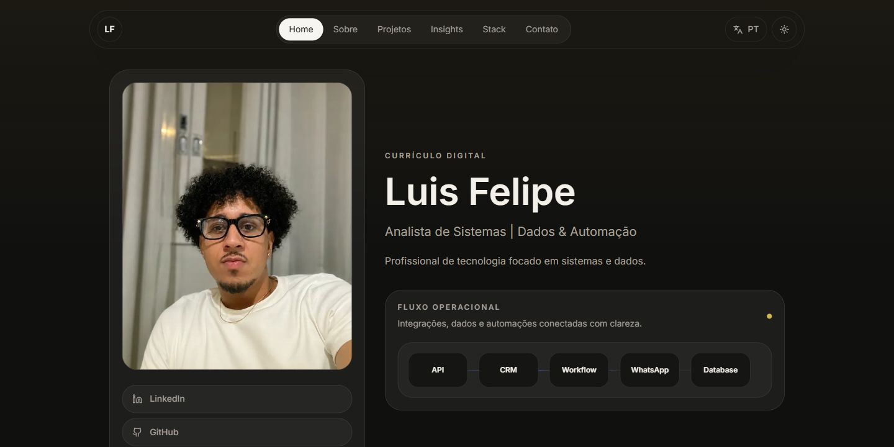
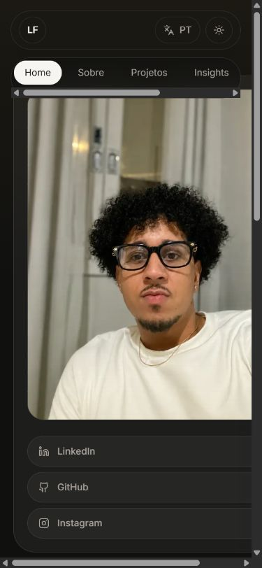

# Luis Felipe — portfólio

Site pessoal e currículo digital com projetos, experiência e conteúdo sobre sistemas, dados e automação.

**Next.js · TypeScript · Tailwind CSS · Framer Motion**

**Estado:** site em evolução. A apresentação dos projetos e o catálogo técnico são mantidos neste repositório.



Página inicial executada localmente. A captura desktop mostra o conteúdo de apresentação.

<details>
<summary>Ver no celular</summary>

Layout atual no celular. Ajustes de largura em telas estreitas permanecem pendentes.



</details>

## Projetos e estudos de caso

O [catálogo do portfólio](portfolio/README.md) reúne os sistemas, suas capturas e os links para os repositórios. Cada página informa o estágio de desenvolvimento e o material disponível.

## Executar localmente

```bash
npm ci
npm run dev
```

Abra `http://localhost:3000`. Para gerar o build, use `npm run build`.

## Conteúdo

Os textos, links, projetos, experiência e stack ficam em `data/site.ts`. A interface oferece português e inglês, temas claro e escuro e navegação por seções.

Para publicar na Vercel, importe o repositório com o preset Next.js e o comando de build `npm run build`.
