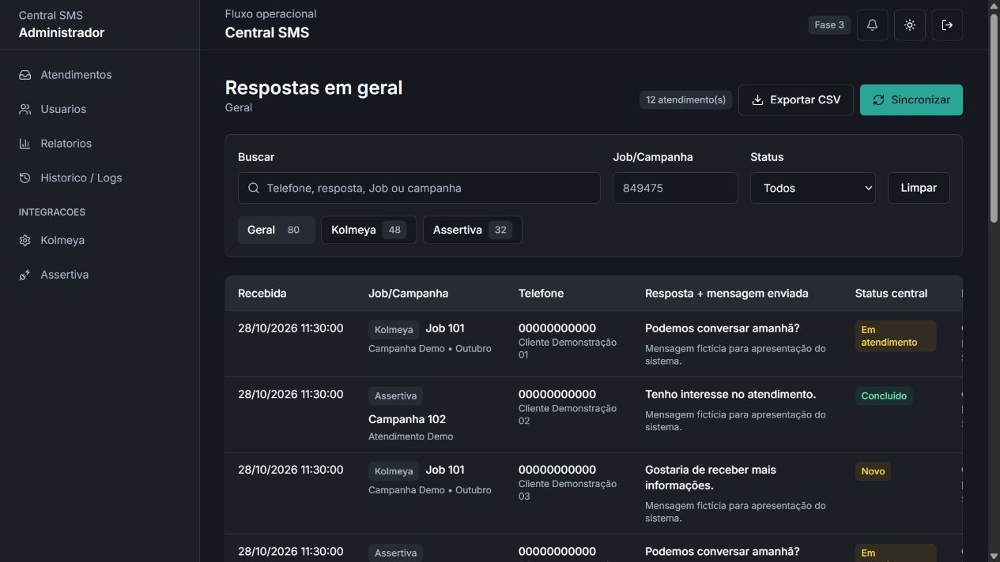
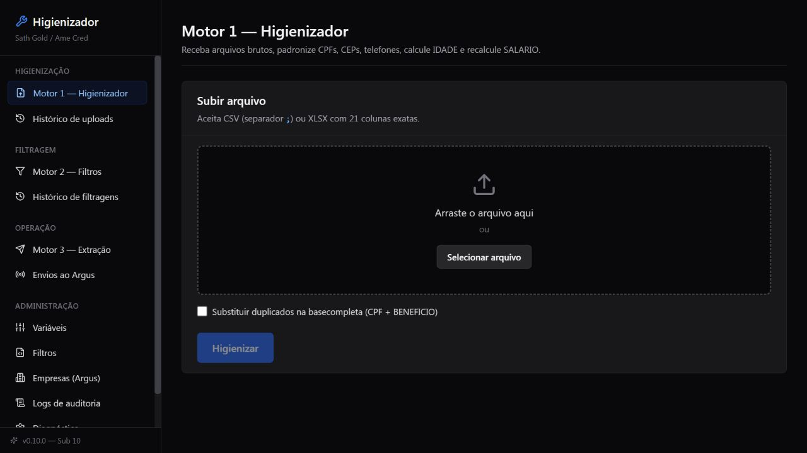
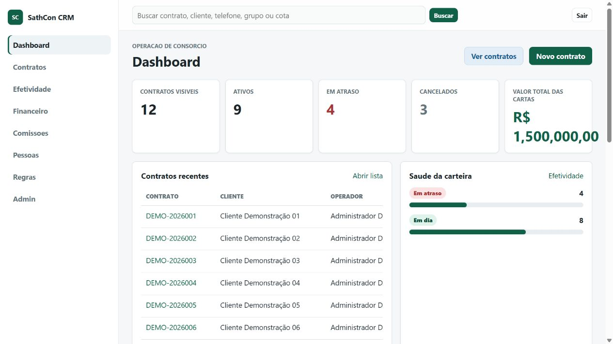

# Portfólio técnico · Luis Felipe

Sistemas, integrações, automação e dados — com código, decisões técnicas e interfaces demonstráveis.

Cada projeto informa seu estágio e o que pode ser explorado. As capturas de sistemas internos usam ambientes locais isolados e exemplos fictícios. Projetos em desenvolvimento aparecem com esse estado explícito.

| Projeto | Foco | Material e estado |
| --- | --- | --- |
| [Atlas Run](https://github.com/jovemfelpitos/atlas-21k) | Planos de treino e acompanhamento | Em desenvolvimento · código e testes |
| [CRM interno](https://github.com/jovemfelpitos/internal-crm-case-study) | Clientes, equipes e fluxos operacionais | Código público · demonstração local |
| [Governança de leads](https://github.com/jovemfelpitos/lead-governance-case-study) | Qualidade de dados, elegibilidade e lotes | Estudo de caso · capturas locais |
| [Central SMS](cases/sms-operations/README.md) | Atendimentos e integrações | Em desenvolvimento · estudo de caso |
| [Higienização de dados](cases/data-quality/README.md) | Ingestão, padronização e extração | Em desenvolvimento · desktop prioritário |
| [CRM de contratos e consórcios](cases/contract-crm/README.md) | Contratos, parcelas e auditoria | Em desenvolvimento · estudo de caso |
| [Convite Olivia](https://github.com/jovemfelpitos/convite-olivia) | Convite com animações e RSVP configurável | Código público · interface implementada |
| [Site pessoal](../README.md) | Currículo digital e portfólio | Em evolução · código público |
| [Vicino](https://github.com/jovemfelpitos/convite) | Convite com exploração de pistas | Protótipo interativo |
| [Vinil Store](https://github.com/jovemfelpitos/vinilstore) | Vitrine de discos com carrosséis | Protótipo de interface |
| [Portfólio Miles Morales](https://github.com/jovemfelpitos/portfolio-milesmorales) | Páginas de portfólio fictício | Estudo de frontend · legado |
| [Stonks+](https://github.com/jovemfelpitos/stonks-plus) | Landing page de streaming fictício | Estudo de frontend · legado |

## Interfaces

Abra o projeto para ver as capturas desktop e celular, o contexto técnico e os limites da demonstração.

### [Atlas Run](https://github.com/jovemfelpitos/atlas-21k)

Planos de treino e acompanhamento. **Em desenvolvimento · código e testes.**

### [CRM interno](https://github.com/jovemfelpitos/internal-crm-case-study)

Clientes, equipes e fluxos operacionais. **Código público · demonstração local.**

### [Governança de leads](https://github.com/jovemfelpitos/lead-governance-case-study)

Qualidade de dados, elegibilidade e lotes. **Estudo de caso · capturas locais.**

### [Central SMS](cases/sms-operations/README.md)

Atendimentos e integrações. **Em desenvolvimento · estudo de caso.**

### [Higienização de dados](cases/data-quality/README.md)

Ingestão, padronização e extração. **Em desenvolvimento · desktop prioritário.**

### [CRM de contratos e consórcios](cases/contract-crm/README.md)

Contratos, parcelas e auditoria. **Em desenvolvimento · estudo de caso.**

### [Convite Olivia](https://github.com/jovemfelpitos/convite-olivia)

Convite com animações e RSVP configurável. **Código público · interface implementada.**

### [Site pessoal](../README.md)

Currículo digital e portfólio. **Em evolução · código público.**

### [Vicino](https://github.com/jovemfelpitos/convite)

Convite com exploração de pistas. **Protótipo interativo.**

### [Vinil Store](https://github.com/jovemfelpitos/vinilstore)

Vitrine de discos com carrosséis. **Protótipo de interface.**

### [Portfólio Miles Morales](https://github.com/jovemfelpitos/portfolio-milesmorales)

Páginas de portfólio fictício. **Estudo de frontend · legado.**

### [Stonks+](https://github.com/jovemfelpitos/stonks-plus)

Landing page de streaming fictício. **Estudo de frontend · legado.**

## Contato

[LinkedIn](https://www.linkedin.com/in/luisfelipeeg1/) · [Site](https://www.luisfelipegn.com/) · [GitHub](https://github.com/jovemfelpitos)
